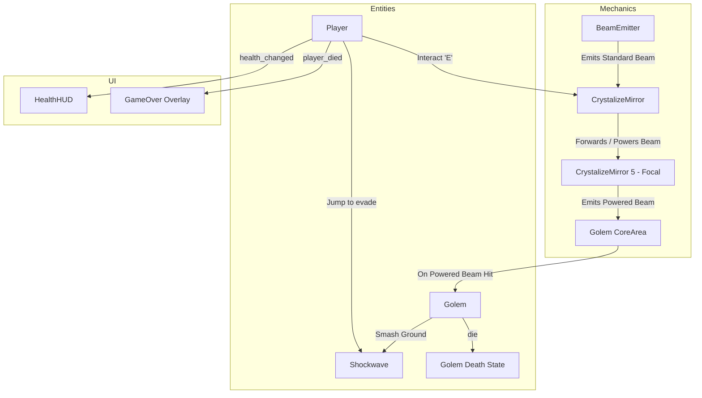

# Spectral Refraction

[-478CBF?logo=godotengine&logoColor=white)](https://godotengine.org/)
[](https://github.com/godot-jolt/godot-jolt)
[](#tech-stack--engine-settings)
[](#project-architecture)

**Spectral Refraction** is a 3D action-puzzle game developed in **Godot Engine 4**. Players step into an ancient chamber confronted by a towering Golem. Invulnerable to standard attacks, the guardian can only be defeated by real-time optical manipulation: aiming interactive crystalline mirrors to refract, combine, and supercharge radiant light beams directly into the Golem's core—all while jumping over ground-splitting shockwaves.

---

## Table of Contents

- [Overview](#overview)
- [Key Features](#key-features)
- [Gameplay & Mechanics](#gameplay--mechanics)
  - [The Refraction & Mirror System](#the-refraction--mirror-system)
  - [The Golem Encounter](#the-golem-encounter)
  - [Player Movement & Controls](#player-movement--controls)
  - [HUD & Health Flow](#hud--health-flow)
- [Controls](#controls)
- [Project Architecture](#project-architecture)
  - [Directory Structure](#directory-structure)
  - [Core Systems Breakdown](#core-systems-breakdown)
  - [Collision Layer Matrix](#collision-layer-matrix)
- [Tech Stack & Engine Settings](#tech-stack--engine-settings)
- [Getting Started](#getting-started)
- [Development Guidelines](#development-guidelines)
- [License](#license)

---

## Overview

In **Spectral Refraction**, the arena is both a puzzle board and a battlefield:

1. **Light Beam Sources:** Fixed beam emitters illuminate the chamber with focused energy rays.
2. **Crystal Mirrors:** Ancient pedestals capture light rays and redirect them. Players interact directly with mirrors to pivot them toward targets.
3. **Beam Supercharging:** Converging multiple beams into specialized focal mirrors supercharges the light (transforming standard cyan beams into high-energy gold/green beams).
4. **Boss Fight Dynamics:** The Golem continuously patrols, tracks the player, and slams the ground to unleash expanding shockwaves.
5. **Win Condition:** Align the mirrors to direct a **powered beam** into the Golem's vulnerable core.

---

## Key Features

- **Dynamic Optical Puzzles:** Continuous raycast-based beam physics that dynamically recalculate reflections, distance, and beam energy in real time.
- **Intelligent Snap Assist:** Optical aiming features magnetic snap-assist, gently easing mirror angles toward target cores for fluid gameplay without frustrating pixel-hunting.
- **Finite State Machine Architecture (FSM):** Fully decoupled state machines powering both the player locomotion/interactions and the Golem boss AI.
- **Jump-to-Dodge Shockwaves:** Real-time expanding 3D GPU particle shockwave rings with precise vertical collision checks (airborne jumping avoids damage).
- **Smooth 3D Camera Controls:** Spring-arm orbit camera that smoothly hands off control to dedicated mirror aiming cameras upon interaction.
- **Cinematic Health & Game Over Flow:** Dynamic UI hearts with impact scaling, damage flash tweens, i-frames, and a fade-to-black restart sequence.

---

## Gameplay & Mechanics

### The Refraction & Mirror System

The light mechanics reside in `src/mechanics/beam/`:

- **`BeamEmitter` (`beam_emitter.gd`):** Casts a RayCast3D to detect receivers and adjusts a 3D cylindrical beam mesh and area light in real time to bridge the exact distance to the hit point.
- **`CrystalizeMirror` (`crystalize_mirror.gd`):**
  - **Beam Forwarding & Loop Prevention:** Uses a lightweight `BeamData` reference counter containing a visited chain array to guarantee beams never cause infinite reflection feedback loops.
  - **Aim Mode:** Interacting (`E`) transitions the player to a dedicated aim camera pivot, locking movement while allowing horizontal rotation (`A` / `D`).
  - **Power Thresholds:** Mirrors can require multiple incoming beams (`required_beams`). When satisfied, they emit a supercharged, high-intensity beam (`powered_beam_color`).
  - **Core Snap Assist:** A secondary snap raycast detects target `CoreArea` collision boxes within an angular tolerance and smoothly tweens mirror rotation to lock on target.

```
[BeamEmitter 1] ───> [Mirror A] ───┐
                                   ├───> [Focal Mirror (2 Beams)] ───> [Powered Beam] ───> [Golem Core]
[BeamEmitter 2] ───> [Mirror B] ───┘
```

### The Golem Encounter

The antagonist operates via an autonomous hierarchical state machine (`src/entities/golem/`):

- **Activate State (`activate_state.gd`):** Plays an awakening animation ("StandUp") before entering the active combat cycle.
- **Idle State (`idle_state.gd`):** Assesses distance to the player and decides between repositioning or attacking.
- **Move State (`move_state.gd`):** Dynamically strafes, pursues, or recenters within the arena boundary (`GolemMovementRange`).
- **Smash Ground State (`smash_ground_state.gd`):** Stomps the ground after a windup, emitting a `Shockwave` instance (`wave.tscn`).
- **Death State (`death_state.gd`):** Triggered immediately when `receive_beam()` registers a `powered` beam impacting its `CoreArea`.

### Player Movement & Controls

The player controller (`src/entities/player/`) features:

- Camera-relative omnidirectional movement (Walk: `3.0 m/s`, Sprint: `5.0 m/s`).
- State-driven physics (`Idle`, `Walk`, `Run`, `Jump`, `Fall`, `Interacting`, `Hit`, `Death`).
- Invincibility window (`1.0 s`) following hits to prevent damage spamming.
- Smooth AnimationTree parameter tweening (`ActionBlend`, `DeathBlend`).

### HUD & Health Flow

- **`HealthHUD` (`src/ui/health_hud/`):** Listens to `health_changed` signals. Dynamically creates and updates heart sprites (`Heart.png`) with scale and modulate tweens on damage.
- **`GameOver` (`src/ui/game_over/`):** Reacts to `player_died`, fading in an ambient backdrop and displaying a retry prompt that safely reloads the current scene.

---

## Controls

| Action | Primary Key | Alternate | Description |
| :--- | :--- | :--- | :--- |
| **Move Forward** | `W` | `Up Arrow` | Move forward relative to camera |
| **Move Backward** | `S` | `Down Arrow` | Move backward relative to camera |
| **Move Left** | `A` | `Left Arrow` | Move left relative to camera |
| **Move Right** | `D` | `Right Arrow` | Move right relative to camera |
| **Look / Rotate Camera** | `Mouse Move` | — | Orbit third-person camera |
| **Jump** | `Space` | — | Jump into air (dodge ground shockwaves) |
| **Sprint / Run** | `Shift` | — | Increase movement speed |
| **Interact / Mount Mirror**| `E` | — | Enter Aim Mode on nearby crystal mirror |
| **Rotate Mirror (Aim Mode)**| `A` / `D` | `Left` / `Right` | Rotate mirror orientation |
| **Exit Aim Mode** | `E` | — | Disengage from mirror & resume movement |

---

## Project Architecture

### Directory Structure

```
spectral-refraction/
├── project.godot                  # Godot engine config, inputs, layers & renderer
├── icon.svg                       # Project icon
├── assets/
│   ├── models/                    # 3D meshes & materials (.glb, textures)
│   │   ├── antagonist/            # Golem boss model, materials, and textures
│   │   ├── crystalize_mirror/     # Crystal pedestal 3D model
│   │   ├── protagonist/           # Hero character 3D model & textures
│   │   └── room_level/            # Level room arena geometry & baked PBR textures
│   └── textures/
│       ├── ui/                    # UI icons (Heart.png, etc.)
│       └── vfx/                   # Particle sprites (shockwave ring textures)
└── src/
    ├── core/
    │   └── state_machine/         # Reusable FSM foundation (StateInterface, StateMachine)
    ├── entities/
    │   ├── golem/                 # Boss entity controller, shockwave, and AI states
    │   │   ├── shockwave/         # Shockwave logic (shockwave.gd, wave.tscn)
    │   │   └── states/            # Golem FSM states (activate, idle, move, smash, death)
    │   └── player/                # Hero controller, camera rig, and locomotion states
    │       └── states/            # Player FSM states (idle, walk, run, jump, fall, etc.)
    ├── levels/                    # Main arena level scene (level.tscn)
    ├── mechanics/
    │   └── beam/                  # Beam emitter, crystal mirrors, and beam data container
    └── ui/
        ├── game_over/             # Game Over screen overlay & restart logic
        └── health_hud/            # Dynamic heart HUD canvas layer
```

### Core Systems Breakdown



### Collision Layer Matrix

The 3D physics layers are organized in `project.godot`:

| Layer | Name | Purpose |
| :---: | :--- | :--- |
| **1** | `Player` | Player CharacterBody3D collider & shockwave hurtbox target |
| **2** | `World` | Room walls, floor, pillars, and static geometry |
| **3** | `Crystal` | Crystal mirror pedestals & interactable zones |
| **4** | `Core` / `Boss Hitbox` | Target collision volume for beam hit validation |

---

## Tech Stack & Engine Settings

- **Engine:** Godot Engine `4.x` (4.3+ / 4.7 forward-compatible)
- **Renderer:** `Forward Plus` (D3D12 on Windows / Vulkan)
- **Physics Engine:** `Jolt Physics 3D` (via Godot Jolt extension / native integration)
- **Window Display:**
  - Stretch Mode: `canvas_items`
  - Aspect: `expand`
  - Mouse Mode: Captured (`MOUSE_MODE_CAPTURED`) for 3D camera navigation

---

## Getting Started

### Prerequisites

1. Download and install [Godot Engine 4.3+](https://godotengine.org/download) (Standard 64-bit).
2. Ensure you have a graphics card with Vulkan or DirectX 12 driver support.

### Running the Project

1. Clone or download this repository:
   ```bash
   git clone https://github.com/Kenosis0/spectral-refraction.git
   ```
2. Open the **Godot Project Manager**.
3. Click **Import**, navigate to the cloned directory, and choose `project.godot`.
4. Click **Import & Edit**.
5. Press <kbd>F5</kbd> (or click the **Play** icon in the upper right) to launch the main scene (`src/levels/level.tscn`).

---

## Development Guidelines

- **State Machine Pattern:** Extend `StateInterface` (`src/core/state_machine/state_interface.gd`) when creating new player or entity states. Register states in the entity's `_ready()` via `state_machine.add_state()`.
- **Signal-First Communication:** Entities and UI components should interact via signals:
  - Player communicates health via `health_changed` and death via `player_died`.
  - Mirrors emit `aim_started`, `aim_ended`, and `power_changed`.
  - Do not tightly couple UI elements to entity internals.
- **Beam Protocol:** Any node that can receive light rays must implement `receive_beam(beam_data: BeamData) -> void`. When relaying beams, always pass a copy of the chain via `beam_data.forwarded_by(self)` to maintain loop detection.

---

## License

This project is open-source and available under the [MIT License](LICENSE) (or applicable repository license). See individual asset folders for specific model/texture credits and licenses.
